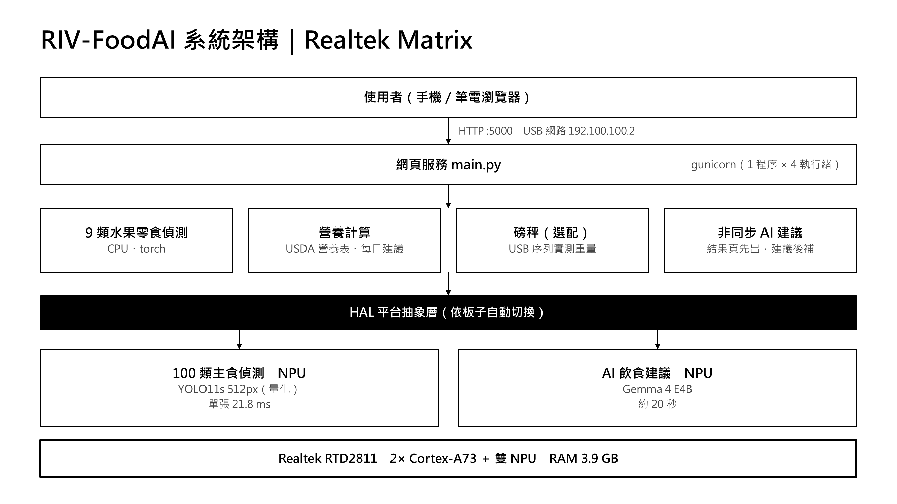
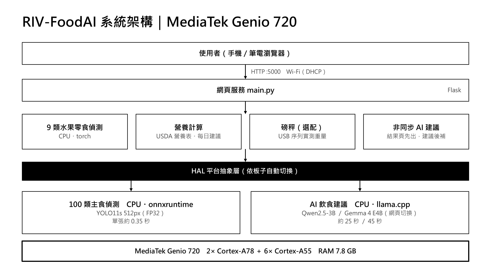
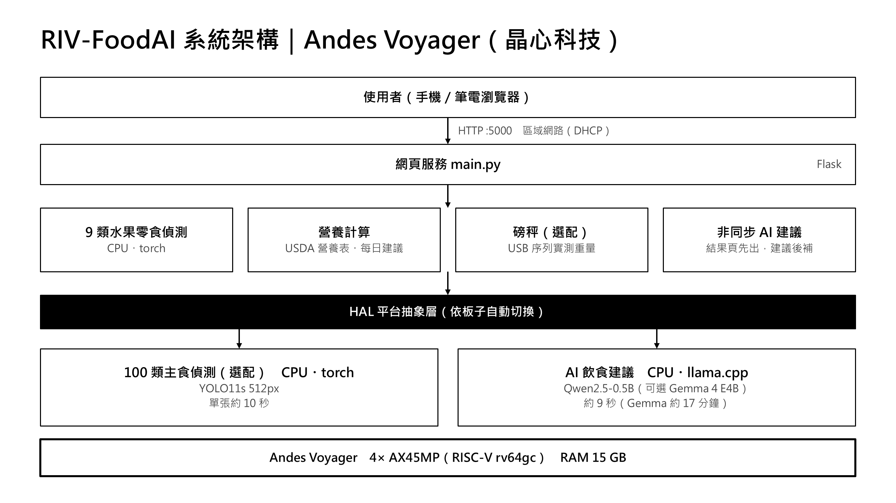
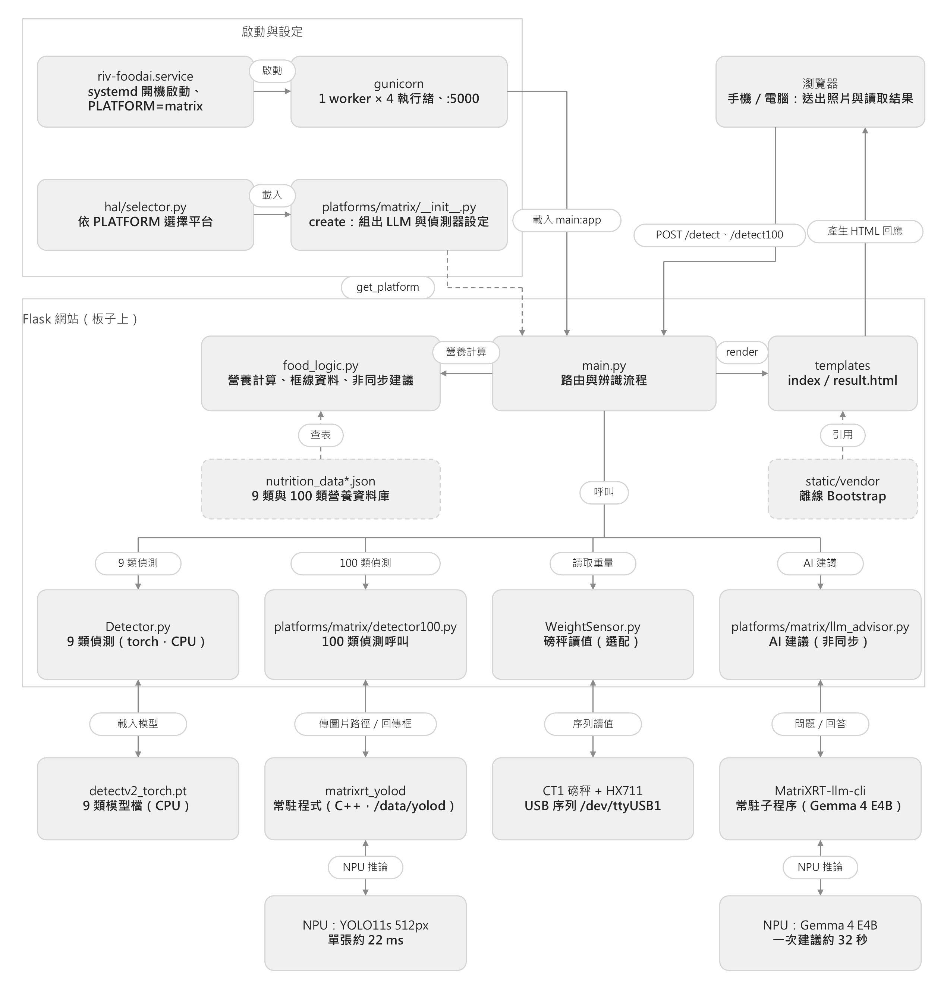
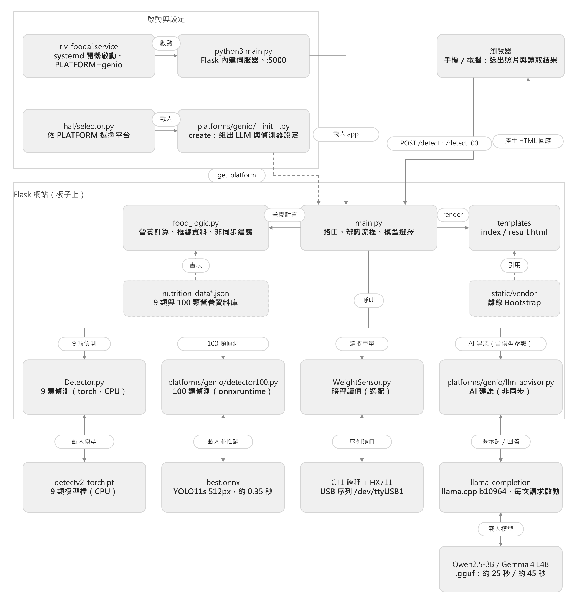
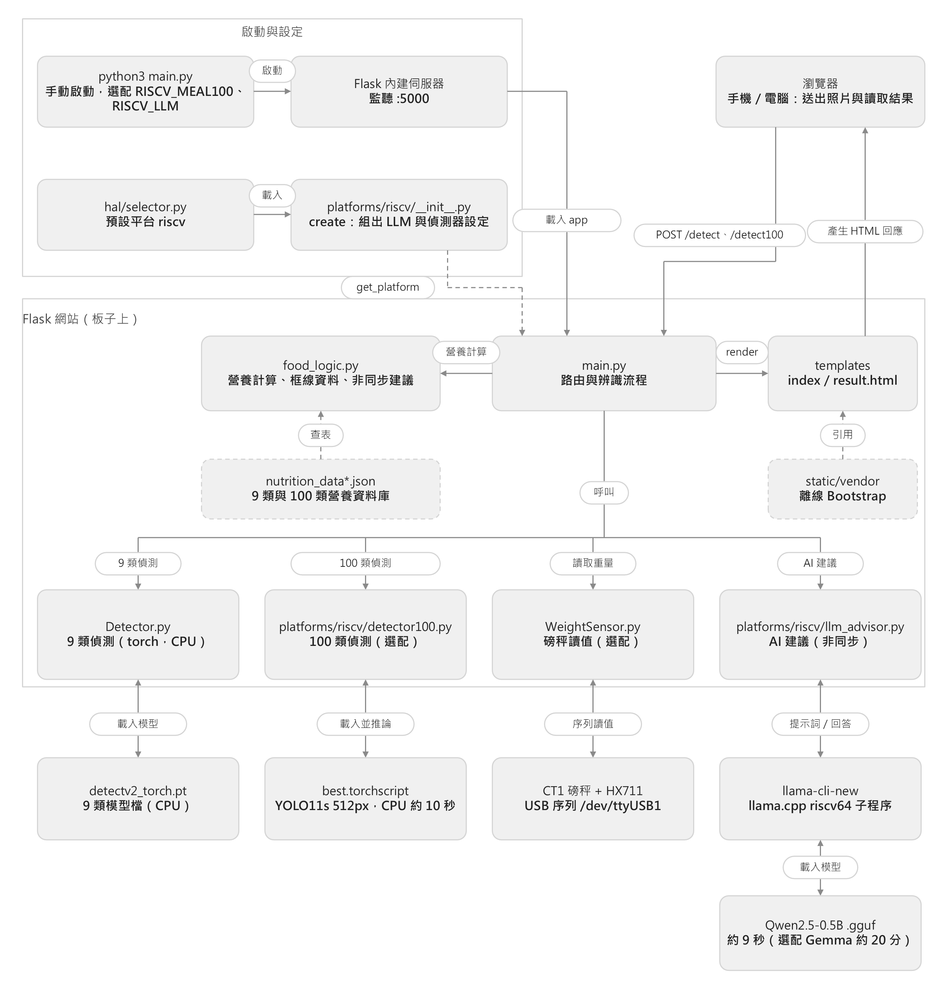

# RIV-FoodAI｜食物拍照辨識與營養估算

拍照上傳 → 偵測食物 → 估算熱量與營養（可搭配磅秤）→ 由板端 LLM 產生飲食建議。全部在開發板上離線執行，用手機或電腦瀏覽器操作。

同一份程式支援三塊板子，用硬體抽象層（HAL）把共用的網頁、營養計算，和各板專屬的偵測與 LLM 分開。

| 板子 | 分支 | 偵測 | AI 建議 | 一次建議時間 |
|---|---|---|---|---|
| **Realtek Matrix**（RTD2811） | `Realtek-Matrix` | 9 類 CPU＋100 類 **NPU** | Gemma 4 E4B（**NPU**） | 約 32 秒 |
| **MediaTek Genio 720** | `Genio_720` | 9 類＋100 類（CPU） | Qwen2.5-3B 或 Gemma 4 E4B（網頁可切換） | 25 至 55 秒 |
| **Andes Voyager（晶心科技）**，RISC-V | `main` | 9 類（CPU）；100 類選配 | Qwen2.5-0.5B；Gemma 4 E4B 選配 | 約 9 秒；Gemma 約 20 分鐘 |

> 本 README 涵蓋三塊板子。要部署哪一塊，就切到該板的分支取檔案（見下方〈取得程式〉）。

---

## 目前進度（2026-10）

| 項目 | Matrix | Genio | Voyager |
|---|---|---|---|
| 9 類水果／零食辨識 | 完成 | 完成 | 完成 |
| 100 類三餐主食辨識（UEC FOOD 100） | 完成（NPU，約 22 ms） | 完成（CPU，約 350 ms） | 完成，選配（CPU，約 10 秒） |
| AI 飲食建議（非同步，結果頁先出） | 完成 | 完成 | 完成 |
| 網頁切換 AI 模型 | — | 完成（Qwen／Gemma） | — |
| 份量滑桿、結果頁疊框、離線 Bootstrap | 完成 | 完成 | 完成 |
| 磅秤（CT1）整合 | 可用（USB 供電問題未解） | 未實測 | 程式支援，未實測 |
| 開機自動啟動（systemd） | 完成 | 完成 | 手動啟動 |
| 100 類辨識與 512px 解析度 | 三板一致 | 三板一致 | 三板一致 |

**待辦**：9 類偵測改跑 NPU（Matrix，省記憶體）、每日累計與個人化營養目標、Genio 磅秤實測、LLM 建議品質評估。

## 系統架構

共用部分（網頁、9 類偵測、營養計算、磅秤、非同步建議）三板相同，差別只在 HAL 以下的 100 類偵測與 LLM。

| Matrix | Genio | Voyager |
|---|---|---|
|  |  |  |

## 程式架構流程圖

檔案層級的呼叫流程：從啟動、瀏覽器請求，到各板專屬的偵測與 LLM 程序。共用的 `main.py`、`food_logic.py`、網頁範本三板相同，差別在最下面兩層。可編輯的 PowerPoint 原檔在 [`docs/diagrams/`](docs/diagrams/)。

**Realtek Matrix**（偵測與 LLM 都在 NPU 常駐程序）



**MediaTek Genio 720**（CPU；AI 建議可切換 Qwen／Gemma）



**Andes Voyager（晶心科技）**（CPU；100 類與 Gemma 為選配）



## 效能對照

### 100 類偵測（YOLO11s，512px，同一張圖）
| | Matrix（NPU） | Genio（CPU） | Voyager（CPU） |
|---|---|---|---|
| 單張偵測 | 約 22 ms | 約 350 ms | 約 9.9 秒 |
| 網頁一次 `/detect100` | 約 0.6 秒 | 約 0.6 秒 | 12 至 15 秒 |
| 驗證集 mAP50（2,109 張） | 0.701 | 0.706 | 同模型（TorchScript） |

### Gemma 4 E4B 同一份提示詞（244 token，貪婪解碼）
| | Matrix | Genio | Voyager |
|---|---|---|---|
| 運算位置 | NPU | CPU，8 執行緒 | CPU，4 執行緒（rv64gc） |
| 量化 | Q6_K | Q4_0 | Q4_0 |
| 預填速度 | 約 148 tok/s | 20.4 tok/s | 0.48 tok/s |
| 解碼速度 | 5.46 tok/s | 4.52 tok/s | 0.27 tok/s |
| 一次建議總時間 | 32.5 秒 | 54.6 秒 | 1,210.7 秒 |

Matrix 的優勢主要在預填（NPU 快 7.3 倍），解碼只差約 1.2 倍。Matrix 為 Q6_K、另兩板為 Q4_0，輸出長度略有不同。測試腳本在 `benchmark/`。

## 取得程式

```bash
git clone https://github.com/Miller0330/FOOD_AI.git
cd FOOD_AI
git checkout Realtek-Matrix      # 或 Genio_720、main（Voyager）
git lfs install && git lfs pull  # 取得模型檔（NPU 模型與 100 類 TorchScript 模型存在 Git LFS）
```
不需要 LFS 大檔的板子（只跑 9 類）可在 clone 前設 `GIT_LFS_SKIP_SMUDGE=1`。私有 repo 需要 GitHub 帳號與 token。

## 安裝與啟動

三板都以 `PLATFORM` 環境變數選擇平台（`matrix`、`genio`、`riscv`）；沒設時會依板子檔案自動偵測，最後預設 `riscv`。啟動第一行會印出 `[HAL] 平台 = …`。

### Realtek Matrix
連線：板子 USB-C 接電腦，電腦端網卡設 `192.100.100.1/24`，板子 IP 為 `192.100.100.2`，建議設好 SSH 金鑰。除錯序列埠為 115200。
```bash
git lfs pull
./deploy/matrix/deploy_to_board.sh        # 複製程式與模型、安裝 systemd 服務並重啟
```
- 程式在板上的 `/data/RIV-FoodAI-Backup/Riscv2025_Server_scale_Code/`，**一律放 `/data`**（`/root`、`/opt` 重開機或 OTA 會被清）。
- Python 套件裝到 `/data/pylibs`，見 `requirements/matrix.txt`。
- 板上需先有 Gemma4 引擎（`/data/models/gemma4_e4b/`）與修改版 `matrixrt_yolo`；部署腳本會檢查並警告。
- 服務為 `riv-foodai.service`（gunicorn，單一 worker，不可增加）。

### Genio 720
```bash
sh deploy/genio/setup_models.sh [gemma]   # 裝相依套件；加 gemma 會下載 4.6 GB 模型
cd Riscv2025_Server_scale_Code
PLATFORM=genio python3 main.py            # 監聽 0.0.0.0:5000
```
開機自動啟動：把 `deploy/genio/riv-foodai.service` 複製到 `/etc/systemd/system/`，再 `systemctl enable --now riv-foodai`。
模型放 `/root/models/`（Qwen2.5-3B、Gemma 4 E4B、`uecfood_s512/best.onnx`），llama.cpp 用 b10964。
`Genio_720` 分支的首頁有「AI模型選擇」，可每次上傳時選 Qwen2.5-3B 或 Gemma 4 E4B。

### Andes Voyager（RISC-V）
```bash
git clone … && cd FOOD_AI && git checkout main
pip3 install -r requirements.txt
cd Riscv2025_Server_scale_Code
python3 main.py                           # 預設 9 類＋Qwen2.5-0.5B
```
選配：
- 100 類：`git lfs pull --include="models/uecfood_s512/best.torchscript"`，再 `RISCV_MEAL100=1 python3 main.py`。
- Gemma 4 E4B：`RISCV_LLM=gemma python3 main.py`（需另外編譯 llama.cpp，約 20 分鐘一次建議，僅供對照）。

詳細步驟與疑難排解見 `docs/README-matrix.md`、`docs/README-genio.md`、`docs/README-riscv.md`、`docs/RISCV_UPDATE.md`。

## 基本操作

1. 手機或電腦連到和板子同一個網路，瀏覽器開 `http://<板子IP>:5000`。
   - Matrix 預設 `192.100.100.2`（USB 網路）；要讓手機也能連，可在電腦上做連接埠轉送：
     `netsh interface portproxy add v4tov4 listenaddress=0.0.0.0 listenport=5000 connectaddress=192.100.100.2 connectport=5000`，手機再連電腦的 IP。
   - Genio、Voyager 查板子 IP（`ip -4 addr`）即可。
2. 首頁有兩個分頁（有 100 類功能的板子）：**水果／零食辨識**、**三餐主食辨識**。選擇分頁後點選或拍攝照片。
3. 有接磅秤時可在「重量」欄輸入公克數，或使用磅秤讀值；沒有時留 0，系統用典型單份重量估算。
4. 按「辨識」。結果頁會先顯示偵測框、食物清單與營養表，AI 營養師建議約 10 到 50 秒後自動補上（Matrix 約 32 秒）。
5. 結果頁可用份量滑桿調整每種食物的倍數（0.25 至 3 倍），營養即時重算，不必重新辨識。
6. Genio 版：首頁「AI模型選擇」選模型再上傳，只影響該次辨識；結果頁會標示使用的模型。

常用維運指令（Matrix／Genio 為 systemd 服務）：
```bash
systemctl restart riv-foodai       # 重啟
journalctl -u riv-foodai -f        # 看紀錄
curl -s localhost:5000/ | head     # 確認網頁回應
```
冷啟動後第一次請求較慢：Matrix 約 2 至 3 分鐘暖機（載入 torch 與 LLM 引擎）；Genio、Voyager 第一次請求也會多載入模型。

## 疑難排解（常見）

| 狀況 | 處理 |
|---|---|
| 啟動訊息「100 類未啟用」 | 模型檔缺少，或只是 Git LFS 指標檔（約 130 bytes），執行 `git lfs pull` |
| 手機連不到 | 確認同一網路、防火牆放行 5000；Matrix 需電腦做連接埠轉送 |
| 板子改檔後行為沒變（Matrix） | 板子沒有 RTC，會誤用舊 `.pyc`；清掉 `__pycache__` 再重啟 |
| AI 建議一直「取得失敗」 | 看 `journalctl`；Voyager 的 Gemma 路線太慢，網頁等不到，只供對照 |
| 序列埠輸出掉字（Matrix） | 換較短、較好的序列線或 FTDI／CP2102 轉接頭；板上 `dmesg -n 1` 可減少核心訊息洗版 |

## 專案結構
```
Riscv2025_Server_scale_Code/     執行目錄
  main.py                        統一入口（只依賴 hal 介面）
  food_logic.py                  營養計算、份量、非同步建議暫存
  hal/                           平台介面與選擇
  platforms/{matrix,genio,riscv}/  各板專屬的 LLM 與 100 類偵測
  templates/  static/            前端（Bootstrap 已本機化，不需外網）
deploy/{matrix,genio}/           部署腳本與 systemd 服務檔
models/uecfood_s512/             100 類 NPU 模型（Git LFS）
benchmark/                       偵測與 LLM 速度測試腳本
training/                        訓練與 NPU／浮點驗證
tests/                           不需硬體的自動測試（python -m unittest discover -s tests）
docs/                            各板說明、HAL 架構、驗證紀錄、架構圖
```

## 文件
- [`docs/README-matrix.md`](docs/README-matrix.md)：Matrix 完整說明（連線、部署、模型訓練與轉換、疑難排解）
- [`docs/README-genio.md`](docs/README-genio.md)：Genio 說明與加速嘗試紀錄
- [`docs/README-riscv.md`](docs/README-riscv.md)、[`docs/RISCV_UPDATE.md`](docs/RISCV_UPDATE.md)：Voyager 說明、100 類與 Gemma 設定
- [`docs/HAL_ARCHITECTURE.md`](docs/HAL_ARCHITECTURE.md)：架構與如何新增平台
- [`docs/VERIFICATION.md`](docs/VERIFICATION.md)：三板啟動與驗證清單

## 授權與資料來源
**使用範圍**：本專案為研究與競賽展示用途。**未附 LICENSE，保留所有權利，不授權商業使用。** 部分程式碼源自 `BiovlsiSystemGroup/RIV-FoodAI-Y2`（該專案未標示授權）。

**第三方元件與資料**

| 項目 | 授權／條款 | 說明 |
|---|---|---|
| UEC FOOD 100 資料集（東京電通大學） | 僅限非商業研究 | 100 類偵測模型以此資料集訓練，模型權重同樣僅供非商業研究使用 |
| Ultralytics YOLO11 | AGPL-3.0 | 只用於 `training/` 的訓練與評估腳本，部署用的伺服器程式不依賴它。散布其衍生作品或以網路服務提供時，須依 AGPL-3.0 公開對應原始碼 |
| Gemma 4 | Google Gemma 使用條款 | AI 飲食建議使用 |
| Realtek 工具鏈（Reality／Acuity-LLM、`matrixrt`） | Realtek 授權 | 模型轉換與 NPU 推論 |
| USDA FoodData Central（SR Legacy） | 公有領域 | 9 類營養資料 |
| 日本食品標準成分表（八訂）增補 2023 年（文部科學省） | 依文部科學省的利用規約，需註明出處 | 100 類營養資料，逐筆來源見 `docs/NUTRITION_SOURCES_100.md` |
